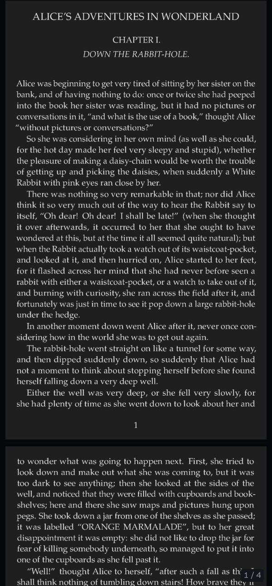
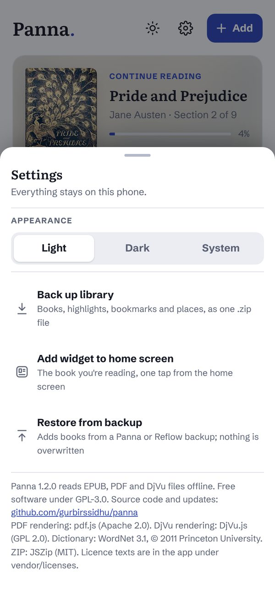

<p align="center"></p>

# Panna

**Panna** (ਪੰਨਾ · पन्ना, "page") is a free, offline reader for **EPUB, PDF and DjVu** on Android.
No accounts, no ads, no tracking. Your books never leave your phone.

<p align="center">
  
  
  
  
</p>

## Download

Get the latest APK from **[Releases](../../releases/latest)**, open it on your phone and allow installing from your browser or file manager. Android 6.0 or newer.

**Updating from 1.1.0:** version 1.2.0 is signed with a new key, so Android will not install it over 1.1.0 ("App not installed" or "package conflicts"). To keep your books and reading places:

1. In Panna 1.1.0, tap the gear icon in the library, then **Back up library**. Save the .zip outside the app (Downloads is fine).
2. Uninstall Panna 1.1.0.
3. Install 1.2.0, tap the gear icon, then **Restore from backup** and pick that .zip.

From 1.2.0 on, updates install normally over the previous version.

**Check that an APK is genuine:** the signing certificate's SHA-256 fingerprint from 1.2.0 onward is

```
CC:09:11:F6:27:27:97:A8:67:FF:F1:52:CF:10:0F:65:C1:C2:30:F3:C2:8E:A1:8D:DB:7C:8B:04:9F:E6:53:BB
```

(Apps such as AppVerifier, or `apksigner verify --print-certs Panna.apk`, show it.)

## New in 1.2.0

- **Home-screen widget** with the book you're reading (details below)
- **Highlights and notes in PDFs**, in the same four colours as EPUBs
- **EPUBs keep their own look:** drop caps, centred headings, small caps, indents and illustrations, while your typeface, text size, line spacing and colours still apply
- **Right-to-left books** (Arabic, Urdu, Hebrew) read in the right direction
- **Menu floats over the page:** tap the middle of the page to show or hide it, and the text never jumps or re-flows. Books open with the menu hidden
- **Bookmarks land on the exact line**, even after you change the text size
- **Volume keys** turn one page per press, and change the volume as usual during read-aloud or while a menu is open
- **Mouse and trackpad** turn pages: one swipe is one page
- **Big libraries back up** in one file, with a progress bar and no 4 GB limit
- **Clear messages:** shared files show "Receiving the file…" while they copy, and DRM-locked shop EPUBs say so instead of failing silently
- **Safer book handling:** scripts and remote content inside books are stripped, and a strict content policy stops a book from loading anything from the internet

## What it does

**Library**
- Continue-reading card, search by title or author, sort, filter by format
- Covers from each book's first page, progress on every book
- Light, dark or follow-the-phone theme
- Back up everything (books, highlights, bookmarks, places) to one .zip and restore it on another phone

**Home-screen widget**
- Add it from the library's settings (gear icon → **Add widget to home screen**), or from your launcher's widget list
- Small size: the cover on a soft blurred background, a progress ring, and how many minutes are left in the chapter
- Wide size: cover, title, author, where you are in the book, and a progress bar
- Tap it to open the book at your place. It follows the phone's light or dark theme

**EPUB**
- Pages or scroll; turn with tap zones, swipes, volume keys, a keyboard or a trackpad
- Text size, three typefaces (including Atkinson Hyperlegible), spacing, line width, hyphenation
- The book's own layout is kept; only your reading settings override it
- Highlights in four colours with notes, bookmarks, full-text search, notes export
- Footnotes open in a popup without losing your place
- Time left in the chapter and in the book

**PDF and DjVu**
- Pages exactly as printed, so equations, tables and diagrams stay intact
- Scroll or one page at a time; pinch or double-tap to zoom
- Trim white margins automatically, so text fills a phone screen
- Night and sepia page colours
- Search, contents and go-to-page
- PDFs: select text to highlight it, add a note, define a word or copy it
- Large PDFs open instantly: only the pages on screen are read from storage

**Everywhere**
- Offline English dictionary (WordNet 3.1): select a word, tap Define
- Read aloud with your phone's own voices; follows the text and turns pages (Hindi and Punjabi voices are used for those scripts when installed)
- Brightness dimmer, full-screen reading, keep screen on
- Open or share EPUB, PDF and DjVu files from any app

<p align="center">
  
  
  
</p>

<sub>Screenshots use public-domain books from Project Gutenberg (*Pride and Prejudice* with Hugh Thomson's illustrations, *Frankenstein*, *Alice's Adventures in Wonderland*) and sample notes written for this page.</sub>

## Privacy

Panna makes no network requests: every feature works offline, and there are no analytics, ads or accounts. (Android lists an internet permission because the app framework adds it by default; the app does not use it.) Everything is stored in the app on your phone. The widget shows the current book's title and cover on your home screen; remove the widget if you'd rather not show it. See [PRIVACY.md](PRIVACY.md).

## Build it yourself

Requirements: Node 20+, JDK 21, Android SDK (platform 35, build-tools 35).

```sh
npm install
npx cap sync android
cd android && ./gradlew assembleRelease
```

The APK is at `android/app/build/outputs/apk/release/`. To sign it, create `keystore.properties` in the repository root (never commit it):

```properties
storeFile=../../keys/your-key.jks
storePassword=...
keyAlias=...
keyPassword=...
```

Without that file the release APK is unsigned.

**Where things are**
- `www/`: the whole interface, plain HTML and JavaScript with no build step: `index.html` (layout and styles), `app.js` (everything else), `theme.js` (applies the saved theme before the first paint)
- `www/vendor/`: pdf.js, DjVu.js, JSZip, the dictionary and their licences
- `android/app/src/main/java/app/panna/reader/`: native code: `MainActivity` (opening and sharing files, volume keys), `ReflowNativePlugin` (bridge to the page: keep screen on, full screen, widget data), `PannaWidget` (the home-screen widget)
- `android/app/src/main/res/layout/widget_*.xml`: the widget's layouts
- [tools/BUILD_ENGINES.md](tools/BUILD_ENGINES.md): rebuilding the bundled engines, dictionary and icons

## Licence

Panna is free software under the [GNU General Public License v3.0 or later](LICENSE).
It bundles pdf.js, DjVu.js, JSZip, WordNet, Capacitor and three open fonts; their licences are listed in [NOTICE.md](NOTICE.md), with full texts in `www/vendor/licenses`.

**Known licensing issue:** DjVu.js is published under GPL 2.0 without the "or later" option, which is not formally compatible with GPL 3.0 or with pdf.js's Apache 2.0 licence. A request to the DjVu.js author to allow "GPL 2.0 or later" is the intended fix; until then, this is noted openly here.

## Credits

Built by Gurbir. Parts of the code were written with the help of an AI assistant (Claude by Anthropic).
