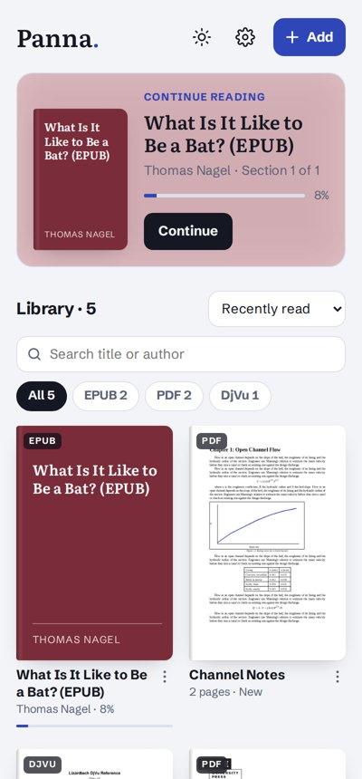
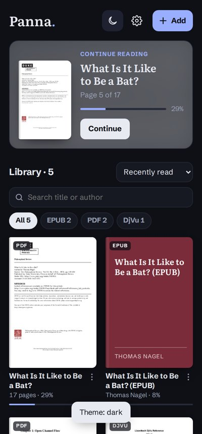
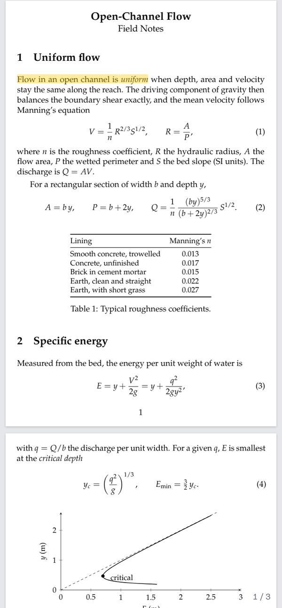

<p align="center"></p>

# Panna

**Panna** (ਪੰਨਾ · पन्ना, "page") is a free, offline reader for **EPUB, PDF and DjVu** on Android.
No accounts, no ads, no tracking. Your books never leave your phone.

<p align="center">
  
  
  
  
</p>

## Download

Get the latest APK from **[Releases](../../releases/latest)**, open it on your phone and allow installing from your browser or file manager. Android 6.0 or newer.

**Updating from 1.1.0:** version 1.2.0 is signed with a new key, so Android will not install it over 1.1.0 ("App not installed" or "package conflicts"). To keep your books and reading places:

1. In Panna 1.1.0, tap the gear icon in the library, then **Back up library**. Save the .zip outside the app (Downloads is fine).
2. Uninstall Panna 1.1.0.
3. Install 1.2.0, tap the gear icon, then **Restore from backup** and pick that .zip.

From 1.2.0 on, updates install normally over the previous version.

**Check that an APK is genuine:** the signing certificate's SHA-256 fingerprint from 1.2.0 onward is

```
CC:09:11:F6:27:27:97:A8:67:FF:F1:52:CF:10:0F:65:C1:C2:30:F3:C2:8E:A1:8D:DB:7C:8B:04:9F:E6:53:BB
```

(Apps such as AppVerifier, or `apksigner verify --print-certs Panna.apk`, show it.)

## What it does

**Library**
- Continue-reading card, search by title or author, sort, filter by format
- Covers from each book's first page, progress on every book
- Light, dark or follow-the-phone theme
- Home-screen widget: the book you're reading, with cover and progress, one tap from the home screen
- Back up everything (books, highlights, bookmarks, places) to one file and restore it on another phone

**EPUB**
- Page-turn or scroll, tap zones, swipe, volume keys
- Text size, three typefaces (including Atkinson Hyperlegible), spacing, line width, hyphenation
- Highlights in four colours with notes, bookmarks, full-text search, notes export
- Footnotes open in a popup without losing your place

**PDF and DjVu**
- Pages exactly as printed, so equations, tables and diagrams stay intact
- Scroll or one page at a time; pinch or double-tap to zoom
- Trim white margins automatically, so text fills a phone screen
- Night and sepia page colours
- Search, contents and go-to-page; select PDF text to define or copy it
- Large PDFs open instantly: only the pages on screen are read from storage

**Everywhere**
- Offline English dictionary (WordNet 3.1): select a word, tap Define
- Read aloud with your phone's own voices; follows the text and turns pages (Hindi and Punjabi voices are used for those scripts when installed)
- Brightness dimmer, full-screen reading, keep screen on
- Open or share EPUB, PDF and DjVu files from any app

## Privacy

Panna makes no network requests: every feature works offline, and there are no analytics, ads or accounts. (Android lists an internet permission because the app framework adds it by default; the app does not use it.) Everything is stored in the app on your phone. See [PRIVACY.md](PRIVACY.md).

## Build it yourself

Requirements: Node 20+, JDK 21, Android SDK (platform 35, build-tools 35).

```sh
npm install
npx cap sync android
cd android && ./gradlew assembleRelease
```

The APK is at `android/app/build/outputs/apk/release/`. To sign it, create `keystore.properties` in the repository root (never commit it):

```properties
storeFile=../../keys/your-key.jks
storePassword=...
keyAlias=...
keyPassword=...
```

Without that file the release APK is unsigned. The interface is plain HTML and JavaScript in `www/` (`index.html`, `app.js`, `theme.js`), with no build step. Native code (file sharing, volume keys, full screen, the home-screen widget) is in `android/app/src/main/java/app/panna/reader/`. See [tools/BUILD_ENGINES.md](tools/BUILD_ENGINES.md) to rebuild the bundled engines, dictionary and icons.

## Licence

Panna is free software under the [GNU General Public License v3.0 or later](LICENSE).
It bundles pdf.js, DjVu.js, JSZip, WordNet, Capacitor and three open fonts; their licences are listed in [NOTICE.md](NOTICE.md), with full texts in `www/vendor/licenses`.

**Known licensing issue:** DjVu.js is published under GPL 2.0 without the "or later" option, which is not formally compatible with GPL 3.0 or with pdf.js's Apache 2.0 licence. A request to the DjVu.js author to allow "GPL 2.0 or later" is the intended fix; until then, this is noted openly here.

## Credits

Built by Gurbir. Parts of the code were written with the help of an AI assistant (Claude by Anthropic).
